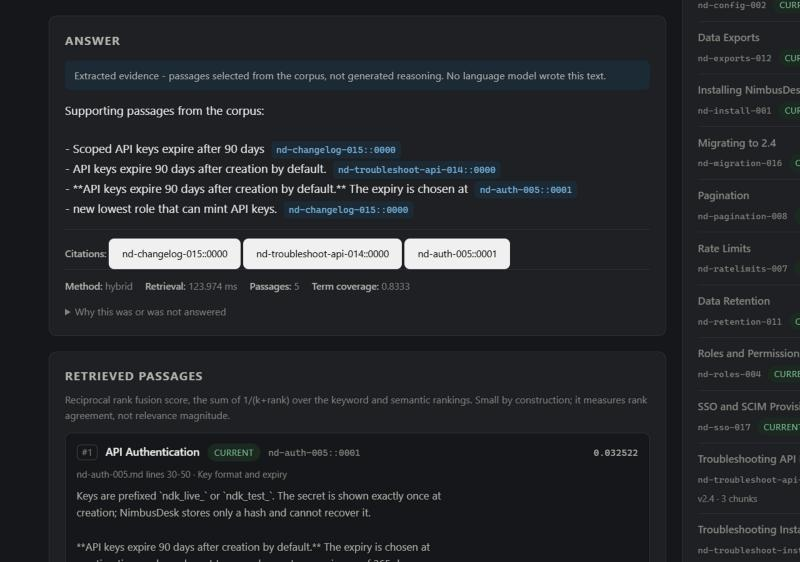
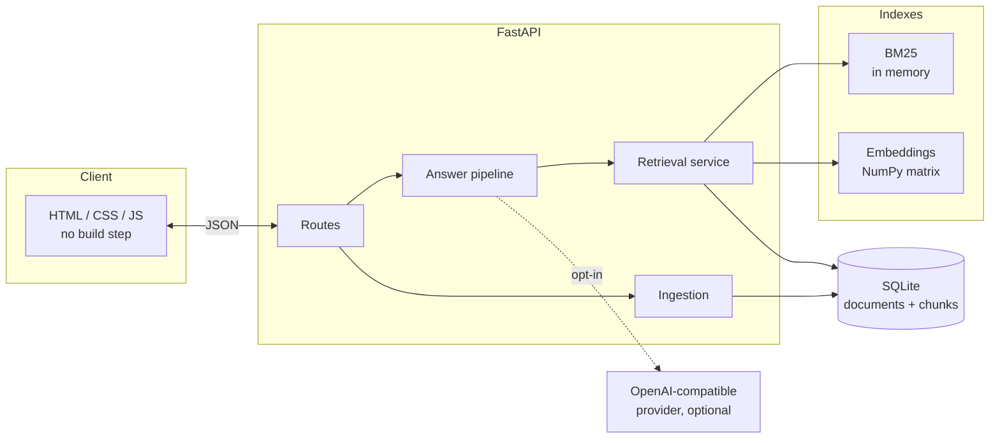

# TraceRAG

Evidence-backed document Q&A with retrieval benchmarking.

TraceRAG answers questions over a document corpus, shows the exact passages
behind every answer, declines when the evidence is not there, and benchmarks
three retrieval methods against a checked-in question set — so the retrieval
claims are measured rather than asserted.

It runs with **no API key**. The default answer mode is extractive and is
labelled as such everywhere it appears.

---



*Extractive mode: evidence with citations that resolve to a source file and line
range. More in [docs/screenshots](docs/screenshots/).*

## The problem

Most document-Q&A demos answer every question, cite nothing you can verify, and
report no numbers. The three things that actually matter in a retrieval system
are the three things usually missing:

1. **Can you see the evidence?** Every citation here resolves to a passage with
   its source filename and line range.
2. **Does it know when to stop?** An explicit abstention heuristic, calibrated
   on a development split, with its reasoning shown to the user.
3. **Is the retrieval any good?** A reproducible benchmark over 20 held-out
   questions, reporting results even where they are unflattering.

## Features

- **Three retrieval methods** — Okapi BM25 (written out, not imported),
  Sentence Transformers + NumPy cosine, and reciprocal rank fusion of the two.
- **Inspectable evidence** — every retrieved chunk with rank, score, document
  status, filename and line range. Scores are labelled per method because they
  are *not* interchangeable.
- **Conservative abstention** — content-term coverage, calibrated on dev
  questions only, with per-term explanation in the UI.
- **Two explicit answer modes** — extractive by default; optional LLM mode via
  any OpenAI-compatible endpoint, with server-side credentials, structured
  output, and citation-ID validation.
- **Version-aware corpus** — includes a superseded document and its current
  replacement, surfaced with status badges.
- **Reproducible benchmark** — Recall@5, MRR@10, abstention behaviour and
  latency, recording corpus hash, model and settings.
- **Ingestion that validates** — 1 MB cap, UTF-8 only, `.md`/`.txt` only,
  filename sanitisation, content-hash dedup, automatic index rebuild.

## Status

Everything described below was built and run. Honest summary:

| Area | State |
| --- | --- |
| Ingestion, chunking, SQLite persistence | Working, tested |
| Keyword / semantic / hybrid retrieval | Working, tested, benchmarked |
| Extractive answers + citations | Working, tested |
| Abstention heuristic | Working, calibrated on dev split |
| LLM mode | Implemented; tested against **mocks only** — never exercised against a live paid provider |
| Frontend | Working, verified in a browser |
| Benchmark CLI | Working; `reports/` comes from a real run |
| Tests | 99 tests, all passing |
| Docker | Image builds and serves (see [Docker](#docker)) |
| CI | Workflow written; **not executed** — no GitHub repository was created |

**Not done:** no LLM-judged semantic correctness scoring, no reranker, no
multi-corpus support, no auth. See [Known limitations](#known-limitations).

---

## Setup

Requires **Python 3.11+** (built and benchmarked on 3.12.10).

```bash
python -m venv .venv
```

```bash
.venv/Scripts/activate      # Windows
```

```bash
source .venv/bin/activate   # macOS / Linux
```

```bash
pip install -r requirements-dev.txt
```

On a CPU-only machine, install the CPU torch build to avoid pulling several GB
of unused CUDA packages:

```bash
pip install --extra-index-url https://download.pytorch.org/whl/cpu -r requirements-dev.txt
```

### Load the sample corpus

```bash
python -m scripts.load_corpus
```

Idempotent — safe to run repeatedly. Downloads the embedding model on first run
(see [Model download](#model-download-and-resources)).

### Run it

```bash
python -m uvicorn app.main:app --host 127.0.0.1 --port 8000
```

Open <http://127.0.0.1:8000>.

### Test

```bash
pytest -q
```

```bash
pytest -q -m "not slow"     # offline; skips model-dependent tests
```

### Benchmark

```bash
python -m app.evaluate --split test --calibrate
```

Writes `reports/benchmark.json` and `reports/benchmark.md`.

### Smoke test

With the server running:

```bash
python -m scripts.smoke_test --base-url http://127.0.0.1:8000
```

## No-key demo

Nothing paid, nothing configured:

1. `python -m scripts.load_corpus`
2. `python -m uvicorn app.main:app --port 8000`
3. Open <http://127.0.0.1:8000> and click the example chips.

The header shows **extractive only** when no provider is configured. Try in
order:

- *"How long do API keys last before they expire?"* — answered, with citations
  that open the source passage.
- *"What is NimbusDesk's phone support number?"* — declined, with the missing
  terms shown.
- *"Do workspace tokens expire?"* — surfaces both the current page and the
  superseded one, with status badges.

A fuller walkthrough is in [docs/demo-script.md](docs/demo-script.md).

## Optional LLM mode

Copy `.env.example` to `.env` and set all three:

```bash
LLM_BASE_URL=https://api.openai.com/v1
LLM_API_KEY=sk-your-key
LLM_MODEL=gpt-4o-mini
```

Any OpenAI-compatible `/chat/completions` endpoint works, including a local one
(Ollama, llama.cpp) at no cost. Credentials stay server-side: they are never
returned by any route, never sent to the browser, and never logged — there is a
test asserting each of those.

In LLM mode the model is asked for `{answer, cited_chunk_ids,
insufficient_evidence}`. Cited IDs are validated against the retrieved set;
invalid ones are dropped, and an answer whose citations were *all* invalid is
rejected. If the provider fails, the response falls back to extractive and says
so explicitly.

> **Tested against mocks only.** The adapter has not been run against a live
> paid provider — this project does not incur API usage automatically.

## Architecture



More detail in [docs/architecture.md](docs/architecture.md); the reasoning
behind each choice is in [docs/design-decisions.md](docs/design-decisions.md).

## Benchmark results

From a real run on the **held-out test split** (20 questions), 18 documents /
53 chunks, `all-MiniLM-L6-v2`, Python 3.12.10 on Windows 11.
Reproduce with `python -m app.evaluate --split test --calibrate`.

| Method | Doc Recall@5 | Doc Hit@5 | MRR@10 | Abstain on no-answer | False refusals | Median | p95 |
| --- | --- | --- | --- | --- | --- | --- | --- |
| keyword | **0.971** | 1.000 | **0.971** | 1.00 | 0.06 | **1.3 ms** | 1.7 ms |
| semantic | 0.912 | 1.000 | 0.894 | 1.00 | 0.18 | 28.2 ms | 37.6 ms |
| hybrid | 0.941 | 1.000 | **0.971** | 1.00 | 0.06 | 26.8 ms | 31.0 ms |

The quality metrics are deterministic and reproduce exactly. The latency figures
do not: across repeated runs on the same machine keyword stayed in 0.7–1.3 ms
and hybrid in 22–28 ms, depending on what else the machine was doing. Read the
ratio (roughly 20–30×), not the third significant figure.

**Hybrid did not beat the keyword baseline on this corpus.** BM25 leads on
Recall@5 and ties on MRR@10, at roughly 30× lower latency. That is the result
the run produced and it is reported as-is. The résumé bullets below quote the
same numbers.

Why this is plausible rather than a bug: the corpus is small (18 documents) and
deliberately uses consistent terminology, which is exactly where lexical search
is strongest. Hybrid's advantage shows on the paraphrase questions, where
semantic retrieval carries it — but averaged over 20 questions that does not
outweigh BM25's precision elsewhere. Hybrid does match the best MRR@10 while
being more robust to paraphrasing than keyword alone, which is the case for
keeping it.

All three methods correctly refused **3/3** unanswerable questions.

### Limitations of these numbers

- **20 questions.** Differences of a few points are within noise. One question
  moves Recall@5 by 0.05.
- **Synthetic, author-reviewed fixtures.** I wrote both the corpus and the
  labels. This is not an independently validated benchmark, and a corpus
  written by the same person who writes the questions is friendlier than the
  real world.
- **Latency is one machine, one process.** It excludes index build and model
  load (both at start-up) and discards 3 warm-up queries. It measures what a
  user waits for, not library performance.
- **Recall@5 penalises multi-document labels by design.** Ambiguous and
  version-conflict questions list 2–3 relevant documents and can only score 1.0
  if all are retrieved. Doc Hit@5 is the gentler companion metric.
- **Citation validity is an identifier check, not accuracy.** It confirms a
  cited ID was in the retrieved context. It does not confirm the claim is
  supported. Semantic correctness is not scored automatically — that needs an
  LLM judge or human grading, and the default benchmark makes no paid calls.

Full per-question tables, the calibration sweep and representative failures are
in [reports/benchmark.md](reports/benchmark.md).

## Known limitations and tradeoffs

- **The abstention heuristic is lexical.** It asks whether the question's terms
  appear in the retrieved passages. It cannot tell that passages mentioning
  every term still fail to answer the question. On the test split it wrongly
  refuses `test-012` ("My export download link stopped working after an hour.
  Is the export gone?") across all three methods — conversational phrasing whose
  terms are not in the answering passage.
- **The 0.55 threshold is corpus-specific.** Calibrated on this dev split; it
  would need recalibrating for another corpus.
- **Chunk size is in characters, not tokens.** A dense table chunk carries more
  tokens than a prose chunk of equal length, and may be truncated by the 256-token
  embedding model.
- **No reranker.** A cross-encoder over the top ~20 would likely be the single
  biggest quality win, at a real latency cost.
- **RRF discards score magnitude.** A dominant BM25 hit contributes the same as
  a narrow first place.
- **LLM mode is unexercised against a real provider.** Mocks cover failures,
  malformed JSON, and invented citations, but no live call has been made.
- **Prompt injection is only partly defensible.** Deterministic guarantees
  (fenced passages, citation-ID rejection) are tested. Whether a model obeys an
  injected instruction is not something prompt wording can guarantee.
- **Single process, in-memory indexes.** Linear in corpus size; fine for
  thousands of chunks, not for millions.
- **No authentication.** Anyone who can reach the port can upload.

## Model download and resources

First run downloads **`sentence-transformers/all-MiniLM-L6-v2`** (~90 MB) from
Hugging Face to `~/.cache/huggingface`. It needs network access **once**;
afterwards everything runs offline.

| Resource | Requirement |
| --- | --- |
| Disk | ~90 MB model + ~2 GB for CPU torch |
| RAM | ~600 MB resident with the model loaded |
| CPU | Any x86-64 / ARM64. No GPU needed or used |
| Start-up | ~3–8 s cold (model load), ~1 s with cached embeddings |

**If the download is unavailable**, TraceRAG keeps working:

- keyword retrieval and extractive answers stay fully functional;
- `semantic` and `hybrid` report `available: false` with the specific reason,
  in `/api/status`, in the UI, and in the benchmark report;
- requesting them returns HTTP 503.

It never silently substitutes BM25 under the hybrid or semantic name. Verify
the degradation yourself:

```bash
EMBEDDING_MODEL=definitely/not-a-real-model python -m uvicorn app.main:app --port 8001
```

## Docker

```bash
docker compose up --build
```

Then <http://localhost:8000>.

The image bakes the embedding model in so the container runs offline. For a much
smaller image that downloads at first run instead:

```bash
docker build --build-arg BAKE_MODEL=false -t tracerag:local .
```

```bash
docker run -p 8000:8000 tracerag:local
```

## Provenance

**Original work (written for this project):** all Python in `app/` and
`scripts/`, all tests, the frontend, the Dockerfile, the CI workflow, and all
documentation. The BM25 and RRF implementations are written out rather than
imported.

**Synthetic data (written for this project):** the 18 NimbusDesk documents in
`data/corpus/` and the 40 evaluation questions in `evaluation/`. NimbusDesk is a
fictional product; every document says so in its header. No employer,
internship, or third-party material is reproduced anywhere in this repository.

**Third-party models and dependencies:** `all-MiniLM-L6-v2` (Apache-2.0, by the
Sentence-Transformers authors) is downloaded at runtime and is not vendored.
FastAPI, Pydantic, Uvicorn, NumPy, httpx, sentence-transformers, PyTorch and
pytest are used under their own licences; exact versions are pinned in
`requirements.lock.txt`.

## Résumé bullets

Drafted from implemented, verified work only:

> Built an evidence-backed document Q&A service (FastAPI, SQLite, NumPy)
> implementing Okapi BM25, Sentence-Transformers semantic search, and reciprocal
> rank fusion; benchmarked all three on a 20-question held-out set, measuring
> document-level Recall@5 of 0.97 (BM25) and 0.94 (hybrid) at single-digit and
> ~27 ms median retrieval latency respectively.

> Designed a calibrated abstention heuristic that correctly refused 3/3
> unanswerable questions while wrongly refusing 1 of 17 answerable ones, and
> a server-side citation validator that rejects model-generated references
> outside the retrieved context; covered both with 99 tests including
> prompt-injection and provider-failure fixtures.

## Repository layout

```
app/              application code
  retrieval/      bm25, embeddings, fusion, service
  answering/      evidence, llm adapter, pipeline
  static/         frontend (no build step)
data/corpus/      18 synthetic NimbusDesk documents
evaluation/       20 dev + 20 held-out test questions
reports/          benchmark output from a real run
scripts/          corpus loader, HTTP smoke test
tests/            99 tests + adversarial fixture
docs/             architecture, design decisions, demo script
```

## Commands

| Task | Command |
| --- | --- |
| Install | `pip install -r requirements-dev.txt` |
| Load corpus | `python -m scripts.load_corpus` |
| Run | `python -m uvicorn app.main:app --port 8000` |
| Test | `pytest -q` |
| Test offline | `pytest -q -m "not slow"` |
| Benchmark | `python -m app.evaluate --split test --calibrate` |
| Smoke test | `python -m scripts.smoke_test` |
| Docker | `docker compose up --build` |
