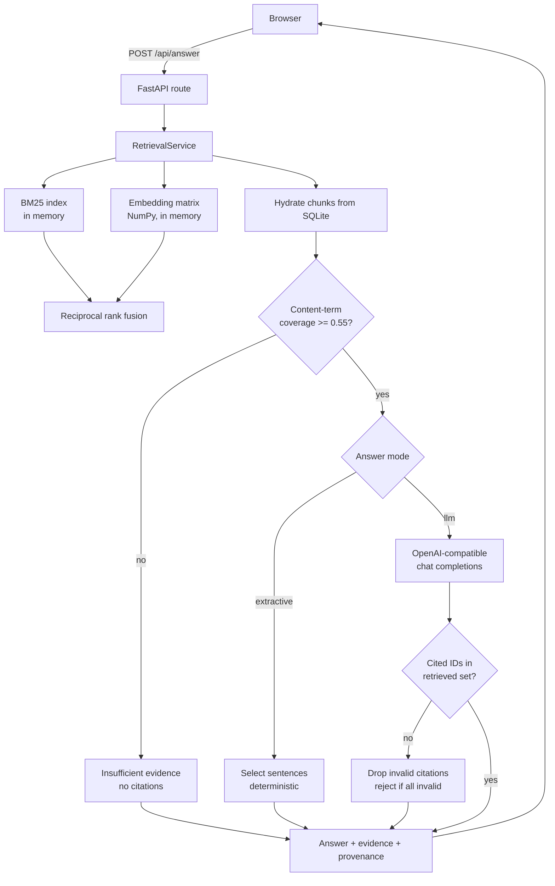

# Architecture

TraceRAG is one FastAPI process. There is no queue, no vector database, no
separate worker. The corpus is small enough that the simplest thing that can
work is also the fastest thing, and a single process is far easier to reason
about and to benchmark.

## Request flow



## Modules

| Module | Responsibility |
| --- | --- |
| `app/config.py` | Environment-driven settings. The only place secrets are read. |
| `app/chunking.py` | Frontmatter parsing and line-aligned overlapping chunking. |
| `app/db.py` | SQLite schema and all persistence. No business logic. |
| `app/ingest.py` | Validation, sanitisation, dedup, chunk creation, rechunking. |
| `app/retrieval/bm25.py` | Okapi BM25, written out rather than imported. |
| `app/retrieval/embeddings.py` | Sentence Transformers + cached NumPy matrix. |
| `app/retrieval/fusion.py` | Reciprocal rank fusion. Pure function, no state. |
| `app/retrieval/service.py` | Index lifecycle, method availability, one result shape. |
| `app/answering/evidence.py` | Abstention heuristic and sentence selection. |
| `app/answering/llm.py` | Provider adapter, prompt construction, citation validation. |
| `app/answering/pipeline.py` | Orchestration: retrieve, assess, answer or abstain. |
| `app/api.py` | HTTP surface and the static frontend mount. |
| `app/evaluate.py` | The benchmark CLI. |

The dependency direction is strictly one way: `api` → `answering` → `retrieval`
→ `db`. Nothing lower imports anything higher, so every layer is testable on its
own, and `retrieval` and `answering` have no knowledge of HTTP at all.

## Storage

Three tables.

- `documents` — one row per ingested document, including its **raw text**. Keeping
  the original means chunking configuration can change without re-uploading
  anything; `rechunk_all` rebuilds from this column.
- `chunks` — the retrievable unit, with `heading`, `start_line` and `end_line`
  pointing back into the original file so every citation is locatable.
- `index_meta` — the corpus fingerprint and embedding model name.

Chunk IDs are `{doc_id}::{ordinal:04d}`. They are human-readable deliberately:
they appear in citations, in the UI, and in the benchmark, and an opaque UUID
would make all three harder to debug.

## Index lifecycle

Both indexes are in-memory and are rebuilt from SQLite. A **corpus fingerprint**
decides when:

```
sha256(sorted(doc_id, content_hash) + chunk_size + chunk_overlap + embedding_model)
```

Any change to corpus content, chunking, or the embedding model moves the
fingerprint, and `ensure_index()` rebuilds. Embeddings are cached to
`data/index/embeddings.npy` keyed by that same fingerprint, so a restart with an
unchanged corpus reloads vectors from disk instead of recomputing them.

The model is loaded at start-up even on a cache hit. That is deliberate: it
makes "semantic is available" mean *can serve a query now*, rather than *has
vectors on disk*, and it moves a multi-second cost off the first user request.

## Degradation

Semantic retrieval is optional at runtime. If the model cannot be loaded, the
embedding backend records the reason and:

- `keyword` stays available;
- `semantic` and `hybrid` report `available: false` with that reason, in
  `/api/status`, in the UI, and in the benchmark report;
- requesting them returns **HTTP 503**, not a silent fall back to BM25.

Never substituting one method under another's name is the point. A benchmark
that quietly reported BM25 numbers under "hybrid" would be worse than useless.

## Trust boundaries

Everything ingested is untrusted data.

- Uploads are size-capped, UTF-8 validated, extension-checked, and filenames are
  flattened to a safe basename.
- The frontend renders all document-derived text through an escaping helper.
  Document HTML is never injected.
- In LLM mode, passages are fenced in `<passage>` tags and the system prompt
  states they are data, not instructions.
- Cited chunk IDs are validated against the retrieved set server-side. This is
  a deterministic check and is the only part of injection defence that is
  actually guaranteed; see `docs/design-decisions.md`.
